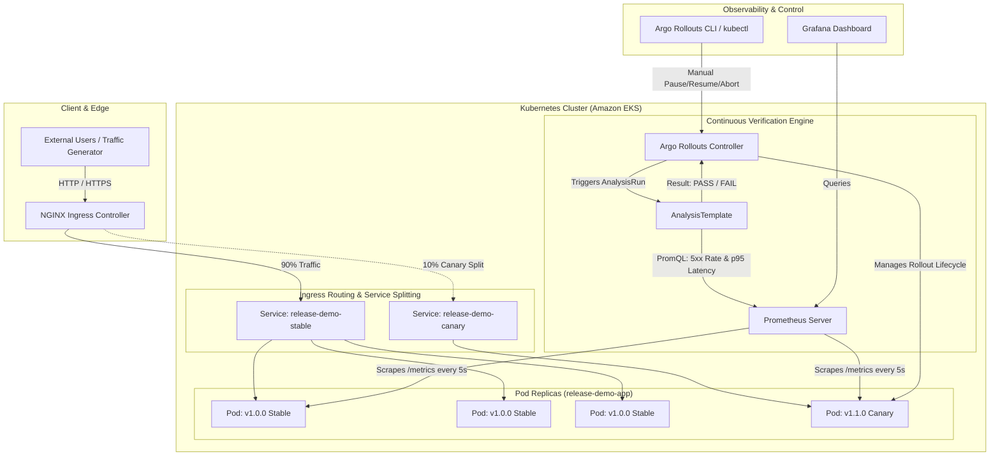

# System Architecture & Traffic Routing

## 1. Overview

The **Progressive Delivery Platform** decouples software deployment (pushing pods to a cluster) from software release (exposing features to users). By integrating **Argo Rollouts**, **NGINX Ingress Controller**, and **Prometheus**, releases are governed by quantitative Service Level Objectives (SLOs) rather than manual guessing.

## 2. Core Components

### 2.1 Application Layer (`release-demo-app`)
* **Framework:** Python FastAPI with native asynchronous request handling.
* **Telemetry:** Instrumented with `prometheus-fastapi-instrumentator` exposing standard golden signals: request rate, status code counters, and latency histograms.
* **Controlled Failure Simulation:** Protected endpoints (`/api/simulate/failure` and `/api/simulate/latency`) protected by authentication tokens, allowing deterministic chaos testing during canary analysis.

### 2.2 Traffic Routing Layer (NGINX Ingress)
In standard Kubernetes, a `Service` distributes traffic evenly across all pods matching its selector using round-robin IPTables or IPVS.
* **The Limitation:** If you deploy 1 canary pod and 3 stable pods, the canary inevitably receives $1/(1+3) = 25\%$ of traffic. You cannot achieve fine-grained steps like 5% or 10%.
* **The Solution:** Argo Rollouts integrates directly with NGINX Ingress, dynamically injecting the `nginx.ingress.kubernetes.io/canary-weight` annotation into a secondary canary ingress object, guaranteeing exact L7 percentage traffic splits regardless of pod replica counts.

### 2.3 Automated Decision Engine (Argo Rollouts & Prometheus)
* **AnalysisTemplates:** Declarative specifications that define queries sent to Prometheus.
* **Acceptance Gates:**
  1. **HTTP 5xx Error Rate:** Must stay $\le 2\%$.
  2. **p95 Latency:** Must stay $\le 400\text{ms}$.
* **Automated Action:** If a query breaches the threshold for the configured failure limit, Argo Rollouts immediately resets canary ingress traffic to 0%, halts the promotion, and scales down canary pods.
