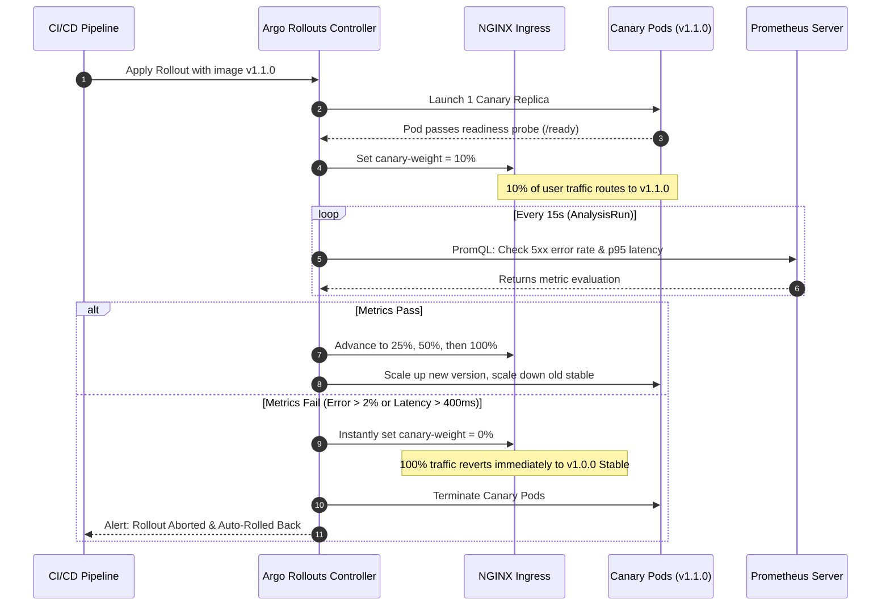

# Deployment Strategies: Rolling vs. Blue-Green vs. Canary

## 1. Strategy Comparison Matrix

| Strategy | Traffic Splitting Mechanism | Blast Radius Control | Resource Overhead | Instant Rollback? | Best Use Case |
| :--- | :--- | :--- | :--- | :--- | :--- |
| **Standard Rolling Update** | Replica-based round-robin | ⚠️ Poor (All users eventually hit new pods) | Low ($1\times$ normal) | ❌ Slow (Must reverse roll pods) | Minor, non-breaking cosmetic changes |
| **Blue-Green Deployment** | All-or-nothing service switch | 🟡 Medium (Preview pods tested before 100% cut) | High ($2\times$ pods during release) | ✅ Fast (Switch service selector back) | Monolithic releases, database schema transitions |
| **Canary with Traffic Shifting** | Weighted L7 Ingress (e.g. 10%, 25%, 50%) | 🟢 Minimal (Only small user slice exposed) | Low-Medium ($\approx 1.25\times$) | ✅ Instant (Reset Ingress canary weight to 0%) | High-throughput production APIs, microservices |

---

## 2. Deep Dive: Replica Weighting vs. L7 Traffic Splitting

### Why Replica-Based Weighting Fails in Production
A common misconception is that running a canary rollout with a standard Kubernetes Service provides controlled traffic splitting.
If you specify:
```yaml
strategy:
  canary:
    steps:
      - setWeight: 10%
```
Without a traffic router (like NGINX Ingress, ALB, or Istio), Argo Rollouts attempts to adjust pod replica counts to match the weight.
* For 4 total replicas, 10% requires $0.4$ pods. Since pods are discrete integers, it will round to 1 pod ($25\%$).
* In order to achieve a true 5% step, you would have to scale to 20 total replicas!
* Long-lived HTTP/2 or WebSocket connections will pin to whichever pod accepted the initial handshake, completely defeating round-robin assumptions.

### How NGINX Ingress Solves This
By specifying `trafficRouting.nginx.stableIngress: release-demo-ingress`, Argo Rollouts creates a shadow Ingress resource annotated with:
```yaml
nginx.ingress.kubernetes.io/canary: "true"
nginx.ingress.kubernetes.io/canary-weight: "10"
```
NGINX's L7 Lua/OpenResty routing engine independently splits incoming requests at the proxy level:
* Exactly 10 out of every 100 requests reach the canary service, regardless of whether you have 1 canary pod or 10.
* Replicas are decoupled from traffic percentages.

---

## 3. Canary Lifecycle & Rollback Mechanics


